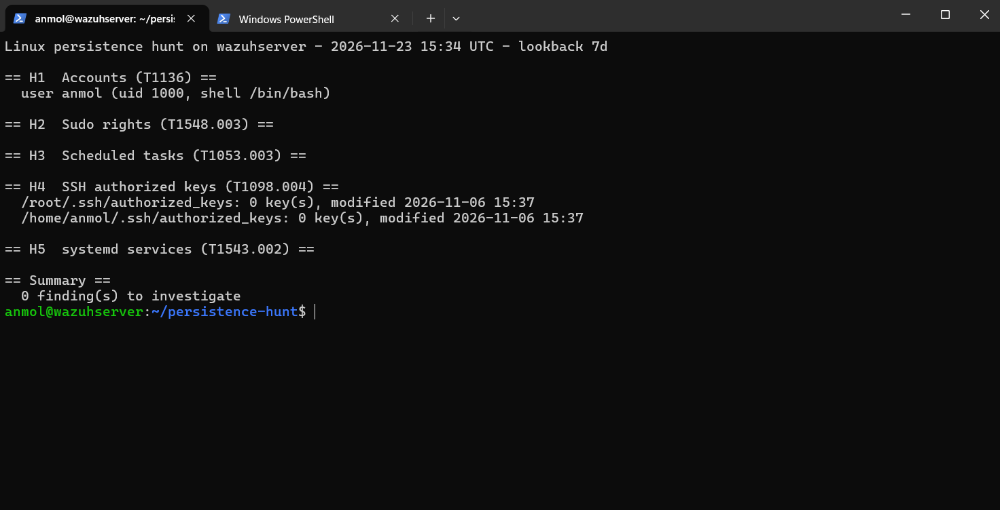
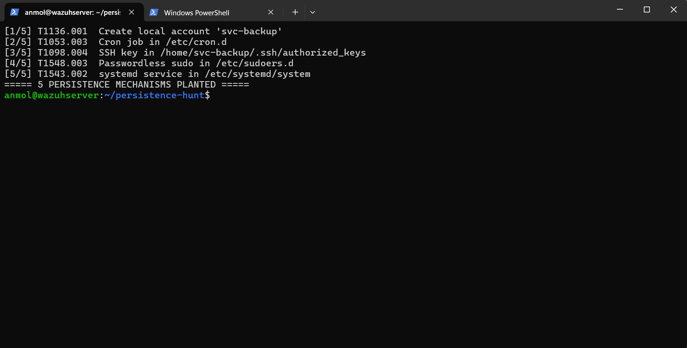
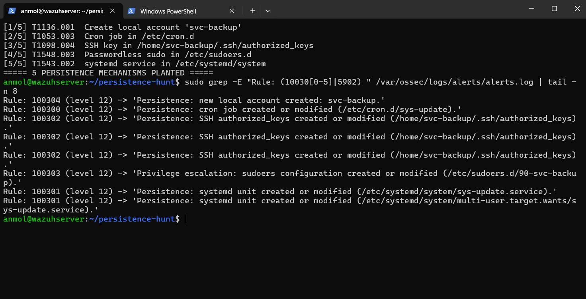
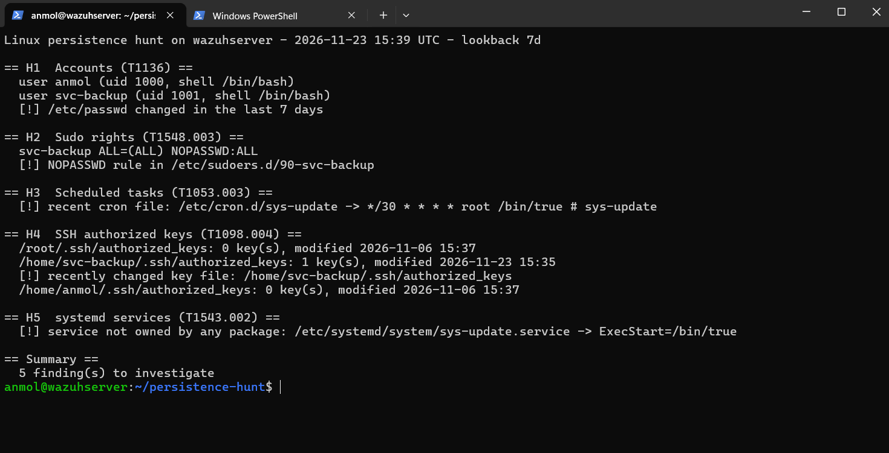
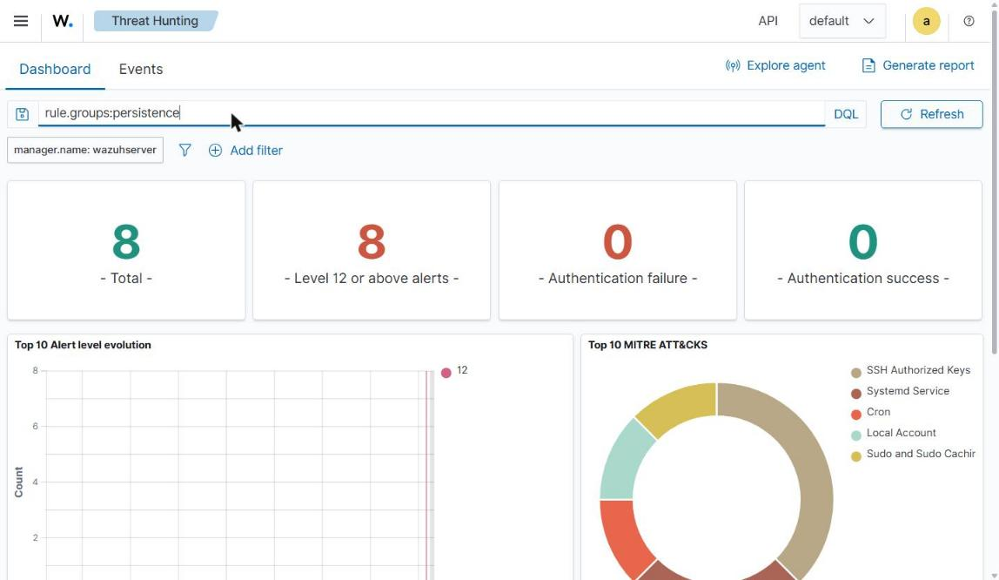
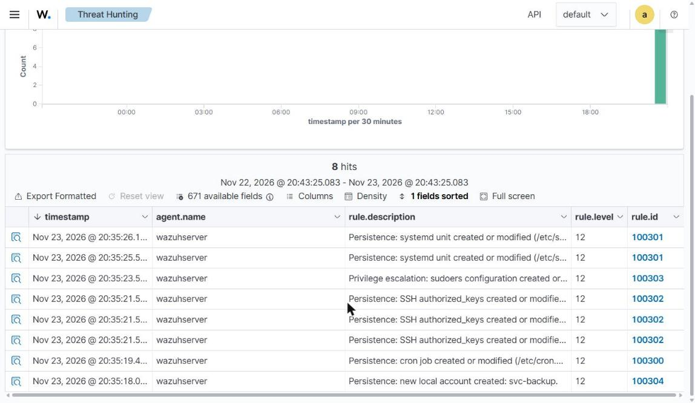
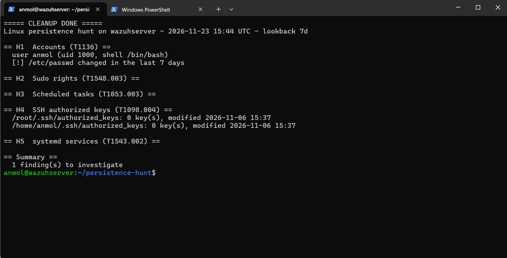

# Linux Persistence Threat Hunt with Wazuh

A hypothesis-driven threat hunt for the five most common Linux persistence techniques. I planted them in a lab, found them twice (once with Wazuh detections, once with a manual hunt that uses no alerts at all), then cleaned up and documented the result as a hunt report.

Part 4 of my Wazuh home-lab series:
[Part 1: brute-force detection](https://github.com/AnmolNisar/wazuh-bruteforce-detection-lab) ·
[Part 2: ransomware detection with FIM](https://github.com/AnmolNisar/wazuh-fim-ransomware-detection) ·
[Part 3: CIS hardening](https://github.com/AnmolNisar/wazuh-cis-hardening)

> The simulation only plants harmless artefacts (the cron job and service run `/bin/true`, the SSH private key is destroyed immediately, the account has no password). Run it only on a lab VM you own.

## Results

| | Baseline hunt | After attacker | After cleanup |
|---|---|---|---|
| Manual hunt findings | 0 | **5** | 1 (expected residue) |
| Wazuh persistence alerts | 0 | **8** (all level 12) | - |
| Techniques detected | - | **5 / 5** | - |
| Time from first to last backdoor | - | 8 seconds | - |

## Hunt hypotheses

| # | Hypothesis | MITRE ATT&CK | Where to look |
|---|---|---|---|
| H1 | An attacker created a local account to come back with | T1136.001 Create Account: Local Account | journald `useradd`, `/etc/passwd` |
| H2 | An attacker granted themselves passwordless sudo | T1548.003 Sudo and Sudo Caching | `/etc/sudoers`, `/etc/sudoers.d/` |
| H3 | An attacker scheduled code to run with cron | T1053.003 Scheduled Task/Job: Cron | `/etc/cron.d`, `/var/spool/cron/crontabs` |
| H4 | An attacker added an SSH key for password-less access | T1098.004 Account Manipulation: SSH Authorized Keys | `authorized_keys` under `/root` and `/home` |
| H5 | An attacker installed a service that survives reboot | T1543.002 Create or Modify System Process: Systemd Service | `/etc/systemd/system` |

## How it works

1. **Visibility.** Real-time FIM on every persistence location (`config/fim-persistence-snippet.xml`). Account creation already arrives through journald as built-in rule 5902.
2. **Detection.** Six custom rules mapped to MITRE (`rules/local_rules_persistence.xml`):

| Rule | Level | Detects | Built on | MITRE |
|---|---|---|---|---|
| 100305 | 15 | New account with **UID 0** (root-equivalent) | 5902 | T1136.001 |
| 100304 | 12 | New local account | 5902 | T1136.001 |
| 100300 | 12 | Cron job created or modified | FIM 550/554 | T1053.003 |
| 100301 | 12 | systemd unit created or modified | FIM 550/554 | T1543.002 |
| 100302 | 12 | SSH `authorized_keys` created or modified | FIM 550/554 | T1098.004 |
| 100303 | 12 | sudoers created or modified | FIM 550/554 | T1548.003 |

3. **Manual hunt.** `hunt/persistence-hunt.sh` is a read-only sweep of the same five hiding places that does not rely on any alert: UID-0 accounts, recent `/etc/passwd` changes, NOPASSWD rules, recent cron files, recently changed key files, and services not owned by any package (`dpkg -S`).

## Reproduce it

```bash
sudo bash install.sh                      # adds FIM paths + rules, validates with wazuh-analysisd -t, restarts
sudo bash hunt/persistence-hunt.sh        # baseline
sudo bash attack-sim/persist-sim.sh       # plant the five backdoors
sudo grep -E "Rule: (10030[0-5]|5902) " /var/ossec/logs/alerts/alerts.log | tail -n 8
sudo bash hunt/persistence-hunt.sh        # hunt again
sudo bash attack-sim/cleanup.sh           # remove everything
```

Dashboard hunt: Threat Hunting, query `rule.groups:persistence`. Useful pivots: `rule.mitre.tactic:Persistence`, `syscheck.path:*authorized_keys`, `data.dstuser:svc-backup`.

## Findings (hunt report)

| Time (UTC) | Finding | Rule | Evidence |
|---|---|---|---|
| 15:35:18 | Account `svc-backup` (UID 1001) created | 100304 | journald `useradd` |
| 15:35:19 | `/etc/cron.d/sys-update` runs every 30 min as root | 100300 | FIM added |
| 15:35:21 | SSH key added to `/home/svc-backup/.ssh/authorized_keys` | 100302 | FIM added + modified |
| 15:35:23 | `svc-backup ALL=(ALL) NOPASSWD:ALL` in `/etc/sudoers.d/90-svc-backup` | 100303 | FIM added |
| 15:35:25 | `sys-update.service` created **and enabled** (symlink in `multi-user.target.wants`) | 100301 | FIM added x2 |

**Assessment:** a single actor established five independent persistence mechanisms in eight seconds, which points to a script rather than hands-on-keyboard activity. Any one of them would let the attacker return after the initial access is closed, so all five must be removed together.

**After cleanup:** one finding remains, `/etc/passwd changed in the last 7 days`. This is the expected trace of deleting the account, not a new backdoor. Noting it shows the difference between a true positive and residue of remediation.

## Screenshots

**Baseline hunt: 0 findings**



**Attacker plants five persistence mechanisms**



**Wazuh detects all five (custom rules, level 12)**



**Manual hunt after the attack: 5 findings, no alerts needed**



**Dashboard hunt: `rule.groups:persistence`, 8 alerts across 5 MITRE techniques**



**Attack timeline: eight seconds from first to last backdoor**



**After cleanup: only the expected /etc/passwd residue**



## What I learned

- **Hunting starts with a hypothesis.** Five clear questions, each tied to a MITRE technique, made the hunt finite and repeatable.
- **Detection and hunting are complementary.** The rules caught everything in seconds, but the manual hunt found the same five backdoors with no alerts at all, which is what you need when logging was off or the attacker was there before your rules.
- **Baselines make findings meaningful.** A "0 findings" run before the attack is what turned "there is a cron file" into "there is a new cron file".
- **Context changes severity.** The systemd alert fired twice; the second (the `.wants` symlink) shows the service was enabled to survive reboot.
- **Test your tools.** My first hunt script under-counted findings because of a subshell bug; the before/after comparison exposed it.
- **Remediation leaves traces.** Knowing which leftover findings are expected stops you chasing your own cleanup.

## Repo layout

```
install.sh   installs FIM paths and rules, validates, restarts
rules/       six persistence detection rules
config/      real-time FIM snippet
attack-sim/  persist-sim.sh and cleanup.sh (lab only)
hunt/        persistence-hunt.sh (read-only manual hunt)
docs/        screenshots
```

## License

MIT
